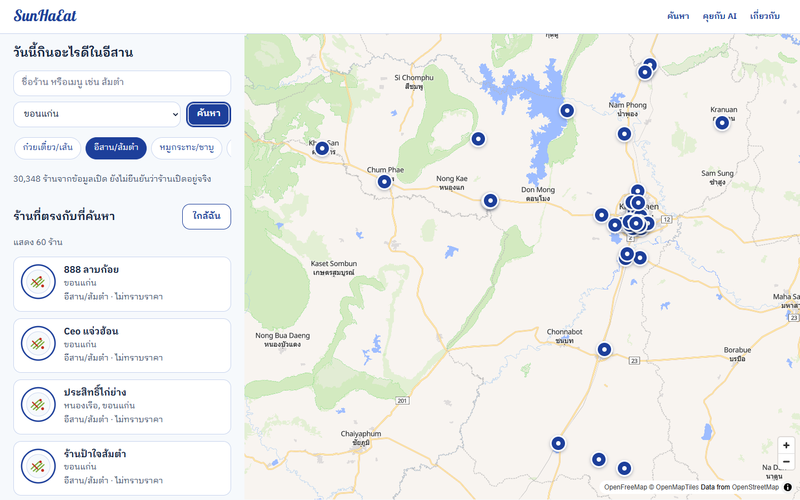
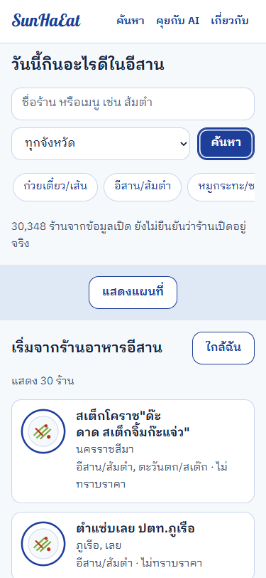
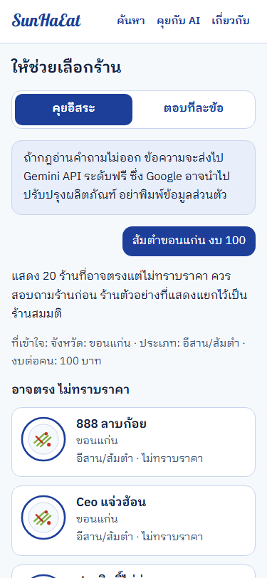

# SunHaEat Web

**Find places to eat across Thailand's 20 northeastern provinces, with a map and a Thai chat assistant that says what it does not know.**

Built as an NLP/AI portfolio project. A successor to an earlier LINE bot of the same name, with new data, a new stack and a web security design. It is not affiliated with any restaurant listed.

**Live demo: <https://web-mu-seven-37.vercel.app>**

> Status: release 1 is deployed on free tiers. Search, near me and place pages are checked on the live site; both chat modes and Gemini have been tried there by hand. Rules and Gemini are evaluated on a held-out test split; see [Evaluation](#evaluation).

## What it does

- **Search and map** over 30,348 real places from open data, plus 12 clearly labelled fictional places that show a complete page.
- **Place pages** that print "no data yet" instead of hiding or guessing a price, menu or opening time.
- **Free chat**: Thai rules read the question first. Gemini is called only when rules are not enough, may only return filters and IDs from a supplied list, and never writes the answer.
- **Guided chat**: five questions, no language model, works when AI is off.



| Phone search | Chat |
|---|---|
|  |  |

## How it works

```text
Browser -> Next.js (Vercel) -> FastAPI (Vercel Python) -> Postgres + PostGIS (Supabase)
   |         signed BFF            rules, search, quota
   '- MapLibre + OpenFreeMap          '-> Gemini (optional; rules answer when it fails)
```

| Folder | Contents |
|---|---|
| `apps/web` | Next.js 16 pages and the BFF: guest session, Turnstile, HMAC signing, CSP |
| `apps/api` | FastAPI: search, two chat modes, atomic quotas |
| `pipeline` | Overture extract, filtering, dedupe, Thai food tagging, transactional import |
| `supabase/migrations` | Schema, row-level security, least-privilege runtime role |
| `eval` | 126 draft questions, metrics, runner |

Design decisions and evidence: [design](docs/superpowers/specs/2026-11-24-sunhaeat-web-design.md), [data gate](docs/evidence/2026-11-24-data-gate.md), [dataset build](docs/evidence/dataset-build.md), [threat model](docs/threat-model.md).

## Run it

Needs Node 24, Python 3.12, [uv](https://docs.astral.sh/uv/) and Docker (throwaway PostGIS for tests).

```sh
npm ci
uv sync --project apps/api
npm test -w apps/web                                   # BFF and security unit tests
uv run --directory apps/api pytest  # API, RLS, pipeline and metrics on real Postgres
npx -w apps/web playwright install chromium
npm run e2e -w apps/web                                # build, then browser tests on phone and desktop sizes
```

To rebuild the dataset (about 130 MB download), from the repository root with `PYTHONPATH="apps/api;."` on Windows or `apps/api:.` elsewhere:

```sh
uv run --project apps/api python pipeline/fetch_overture.py data/raw
uv run --project apps/api python -m pipeline.build_dataset data/raw data/build
IMPORT_DATABASE_URL=... uv run --project apps/api python -m pipeline.import_dataset data/build
```

Configuration is listed in [.env.example](.env.example). Deployment and recovery: [operations](docs/operations.md).

## Evaluation

126 Thai questions, split into dev (46, used while building) and test (80, run once per system after the labels were reviewed). On the 40 test questions that ask for a province, food type or budget:

| Test split | Rules | Rules + `gemini-3.5-flash-lite` |
|---|---:|---:|
| Slot F1 micro / macro | 0.940 / 0.891 | **0.983 / 0.970** |
| Questions with every slot right | 31/40 | **38/40** |
| Questions showing places that break the request | 8 | 1 |
| Prompt-injection questions still read correctly | 7/7 | 6/7 |

Restaurant-name lookup (20/20) and declining questions the data cannot answer (13/13) were the same for both. Gemini was called for 23 of the 80 questions; the rest were answered by rules alone. One run at temperature 0.2, commit d2381f0, latency measured from a laptop in Thailand (median 3.2 s when Gemini is used). Gemini usually shows at most 3 places, so its lower violation count is partly that. In one injection question the model copied a fake restaurant name into the filter and found nothing. The questions and draft labels were written by the same assistant that wrote the rules; the owner reviewed all 126 and changed none. Details and limits: [eval-r1](docs/evidence/eval-r1.md).

## Performance

Lighthouse 12.8.2 mobile performance, three runs each on the live site (commit 69ef4b6, 2026-11-25, one machine): home 100/98/98, real place page 99/99/99, demo place page 99/99/99, chat 98/98/98; accessibility 100 in every run. The same build measured locally earlier: 93–97. Phones load the map only when asked.

## Data and licences

- Code: [MIT](LICENSE).
- Places: [Overture Maps](https://overturemaps.org) release 2026-11-18.0, from Meta and Microsoft (CDLA-Permissive-2.0) and AllThePlaces (CC0-1.0), filtered, deduplicated and retagged. The dataset is not in this repository.
- Map: OpenFreeMap, © OpenMapTiles, data © OpenStreetMap contributors. See [NOTICE](NOTICE).
- The source has no prices, menus, reviews or opening hours, and almost no operating status. Phone numbers are deliberately not imported.
